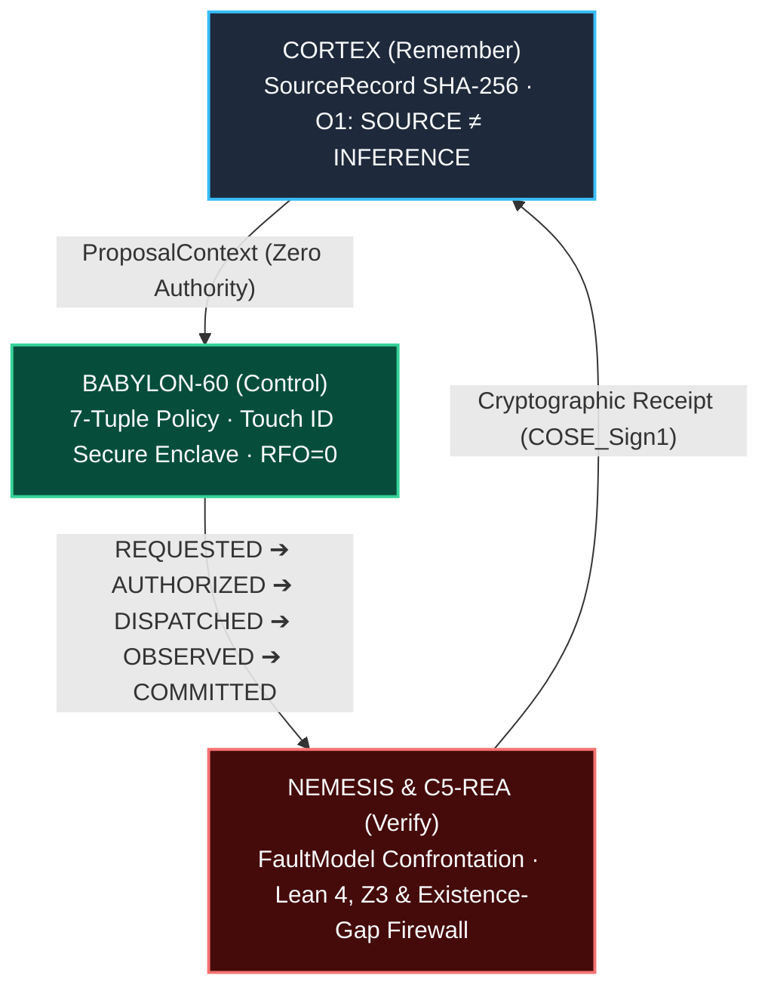

# Telmo Dinámico de Moskv · Systems Architect & Hacker

> **Sovereign AI Infrastructure — Rust Ring-0 · Lean 4 · Z3 SMT · Landauer Bounds (`RFO = 0`)**

[](./FLEET_LEDGER.md)
[](https://opensource.org/licenses/MIT)
[](https://github.com/borjamoskv/BABYLON-60)
[-10b981?style=flat-square)](https://github.com/borjamoskv/c5-rea)

Systems Architect, kernel hacker, and open-source researcher based in **Bilbao, Basque Country**.  
Designing deterministic trust infrastructure and lock-free execution engines for autonomous systems: Ring-0 memory layout, formal verification (Curry-Howard isomorphism), clean-room reverse engineering (`C5-REA`), neurosymbolic firewalls, and cryptographic auditability.

*Operator of the **C5-REAL Sovereign Triad** (`Telmo Dinámico de Moskv` / `Borja Moskv` / `Bakala de Troya`).*

---

## 🏛️ Active Sovereign Fleet (13 Public Flagships + Air-Gapped Appliances)

| Repository | Stack | Function & Verification Scope |
| :--- | :--- | :--- |
| [**`BABYLON-60`**](https://github.com/borjamoskv/BABYLON-60) | Rust · Lean 4 · Python · SQLite WAL | Verified execution authority (`INV-Ω`), `BabylonTrace.lean` formal proofs, L1–L4 evidence gates & single-writer MCP broker |
| [**`c5-rea`**](https://github.com/borjamoskv/c5-rea) | Python Stdlib (`0 deps`) · MCP stdio | Clean-room reverse engineering (`Mach-O` / Electron `.asar` in `<15ms`), `67 KB` Kolmogorov context & Existence-Gap Firewall (`0%` slopsquatting) |
| [**`cortex-persist`**](https://github.com/borjamoskv/cortex-persist) | Python · Rust · SQLite WAL | Tamper-evident cryptographic memory, SHA-256 lineage & epistemic gating (`O1: SOURCE ≠ INFERENCE`) |
| [**`anvil-lang`**](https://github.com/borjamoskv/anvil-lang) | Rust · Z3 SMT · Lean 4 | Formally verified domain-specific systems dialect and execution runtime with SMT & Lean 4 proof emission |
| [**`axiom-0`**](https://github.com/borjamoskv/axiom-0) | Rust (`zero-deps`) | Quantitative Type Theory (QTT) dependent type kernel with Normalization by Evaluation (NbE) & wait-free `SeqlockCell` |
| [**`c5-socint-extraction-suite`**](https://github.com/borjamoskv/c5-socint-extraction-suite) | Python Stdlib (`0 deps`) | Omnivector SOCINT & forensic extraction engine across 11 platforms with Sybil/CIB detection, Merkle trees & STIX 2.1 |
| [**`teorema-robinson-moskv`**](https://github.com/borjamoskv/teorema-robinson-moskv) | Rust · Lean 4 · Python | Formalization and computational verification of the Robinson-Moskv Theorem, BFT cognitive engines & 15 logical constellations |
| [**`flstudio-mcp`**](https://github.com/borjamoskv/flstudio-mcp) | Python · FastMCP · MIDI | Native Model Context Protocol server & real-time MIDI/telemetry bridge for FL Studio 2025 |
| [**`mac-maestro`**](https://github.com/borjamoskv/mac-maestro) | Swift · JXA · Python | Semantic-first macOS WindowServer & Safari automation bridge with safety gates and structured traces |
| [**`escohotado-corpus`**](https://github.com/borjamoskv/escohotado-corpus) | Python · MLX · ShareGPT | 29,628-sample SHA-256 deduplicated semantic corpus & ontology engine on Antonio Escohotado (`Ω₁₁₈`) |
| [**`para-diana`**](https://github.com/borjamoskv/para-diana) | Typst · Pandoc · Lean 4 | Doctoral monograph: *Samuel Beckett as a Subtractive Transducer* & Myhill-Nerode state minimization |
| [**`borjamoskv-site`**](https://github.com/borjamoskv/borjamoskv-site) | Astro · TypeScript · WebAudio | Sovereign brutalist codex ([`borjamoskv.com`](https://borjamoskv.com)), 60/120 FPS Studer A800 tape physics engine & *The Science of Friction* |
| [**`naroa.online`**](https://github.com/borjamoskv/naroa.online) | React · TypeScript · Vite | High-craft digital art platform and interactive hyperrealist portfolio |

> **Air-Gapped & Private Hardware Appliances (`Ring-0 Vault`):**  
> • **`BABYLON-60-VAULT`** *(Rust · Lean 4 · Apple Silicon Secure Enclave)* — 64-byte L1-aligned SPMC Seqlock (`KUDURRU-64`), Touch ID `COSE_Sign1` hardware gate & `NEMESIS` adversarial suite.  
> • **`mandato`** *(Swift · Rust · Local REA)* — Native macOS prompt-to-UI actuator with deterministic policy boundary (`O2: INFERENCE ≠ AUTHORITY`).  
> • **`gflow-studio`** *(Python · DAG Runtime)* — Deterministic audiovisual chapter engine & Google Flow MCP cinema pipeline.  
> • Full cryptographic inventory tracked weekly in [**`FLEET_LEDGER.md`**](./FLEET_LEDGER.md).

---

## 🧬 Architecture & Triadic Invariants



### Constitutional Laws (`INV_C5_CANONICAL_ONTOLOGY`)
* **O1 (`SOURCE ≠ INFERENCE`):** Primary cryptographic records and statistical deductions never share the same table or authority level.
* **O2 (`INFERENCE ≠ AUTHORITY`):** No stochastic model may authorize an irreversible physical effect by itself (`INV-Ω`).
* **O5 (`DECISION ≠ EFFECT`):** Logical authorization is distinct from verified physical outcome in silicon.
* **Existence-Gap Firewall (`C5-REA`):** Zero tolerance for hallucinated imports (*slopsquatting*), hollow truncation stubs, or unverified IPC contracts (`100%` Popperian parity in `<15ms`).
* **Landauer Floor (`RFO = 0`):** Lock-free SPMC 64-byte cache-line alignment minimizing thermodynamic dissipation (`ΔQ ≥ k_B T ln 2`).

---

## ⚡ Quickstart & Verification

Verify the zero-dependency sovereign engines (`c5-socint-extraction-suite`, `c5-rea`, and `axiom-0`) in an isolated RAM workspace with a single command:

```bash
curl -sSfL https://raw.githubusercontent.com/borjamoskv/borjamoskv/main/verify.sh | sh
```

Or clone and run the deterministic test suites directly:

```bash
# 1. Verify C5-REA Clean-Room Reverse Engineering & Existence-Gap Firewall (8/8 tests in 0.004s, 0 deps)
git clone https://github.com/borjamoskv/c5-rea.git && cd c5-rea
python3 -m unittest discover -s tests -v

# 2. Verify the QTT Dependent Type Kernel & Wait-Free Seqlock (Rust, zero external deps)
git clone https://github.com/borjamoskv/axiom-0.git && cd axiom-0
cargo test --all-targets

# 3. Run the 40/40 Deterministic Omnivector SOCINT Test Suite (Pure Python Stdlib)
git clone https://github.com/borjamoskv/c5-socint-extraction-suite.git && cd c5-socint-extraction-suite
python3 tests/test_socint.py
```

---

## 📚 Epistemic Foundations & Lineage

The architecture of **BABYLON-60** and the **C5-REAL** ecosystem converges at the intersection of information thermodynamics, formal methods, and radical humanities:

* **Jorge Luis Borges** (*Combinatorial Memory & Graph Traversal*): *The Library of Babel* as the foundational model for deterministic content-addressed storage and universal state search.
* **Samuel Beckett** (*Subtractive Transduction & State Minimization*): Deliberate impoverishment of noise (*«pour m'appauvrir»*) and reduction to minimal state machines (Myhill-Nerode) in [`para-diana`](https://github.com/borjamoskv/para-diana).
* **Antonio Escohotado** (*Radical Empiricism & Monism of Substance*): Monism of continuous reality, auto-organized order, and empirical falsification over bureaucratic dogma in [`escohotado-corpus`](https://github.com/borjamoskv/escohotado-corpus).
* **Paul Watzlawick** (*Second-Order Change*): Escalation loops (*«the attempted solution is the problem»*) and topological bifurcation (Change 2).
* **Rolf Landauer** (*Thermodynamics of Computation*): The physical floor of information erasure (`ΔQ ≥ k_B T ln 2`).

---

## 🛨️ Technical Stack

```yaml
Languages:      Rust (Ring-0) · Lean 4 (Ring-1) · Python 3.12 · TypeScript · Swift · C-ABI
Formal & REA:   Z3 SMT Solver · Quantitative Type Theory (QTT) · NbE · C5-REA Mach-O/ASAR Dissector
Concurrency:    Lock-Free Seqlock SPMC · L1 Cache Coherence (64B align) · Zero RFO Readers
Security:       Apple Silicon Secure Enclave · Touch ID COSE_Sign1 · SCITT (RFC 9162) · WORM Ledgers
Infra:          POSIX Bare Metal · Apple Silicon UMA · Cloudflare Workers · GitHub Actions
```

---

## 🛡️ License & Security Governance

All public repositories in this fleet are released under the **MIT License** (or Sovereign Dual-License where specified) and enforce deterministic CI verification and [`SECURITY.md`](./SECURITY.md) disclosure policies. For security disclosures or hardware appliance inquiries, refer to each repository's `SECURITY.md` or contact via [babylon60.com](https://babylon60.com) and [cortexpersist.com](https://cortexpersist.com).

*Signed: **Telmo Dinámico de Moskv** (`borjamoskv`) · [babylon60.com](https://babylon60.com) · [cortexpersist.com](https://cortexpersist.com) · [borjamoskv.com](https://borjamoskv.com) · Bilbao, Basque Country*
